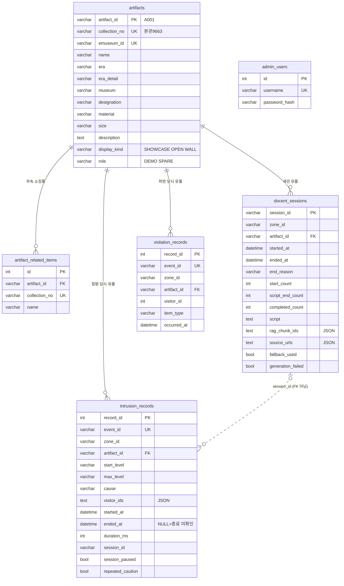

# RDB 설계 초안 (Agent 제안, Web 확정)

작성일 2026-11-05. 작성 송용석(Agent), 확정 김재원(Web). 인터페이스 명세(`docs/interface/interface_spec_v0.1.md`) 4.4 기록 저장 API와 8장 유물 기본 정보를 그대로 받을 수 있게 짠 제안안입니다. 테이블 이름·타입·RDB 종류는 Web에서 바꿔도 되고, **API로 들어오는 필드 이름과 열거값만 명세와 맞으면 됩니다.**

| 파일 | 내용 |
|---|---|
| `schema_draft.sql` | 테이블 6개 DDL (SQLite 기준, MySQL 변환 방법은 파일 머리말) |
| `stats_queries.sql` | FR-WEB-11 통계표 쿼리 예시 5개 |
| `../../interface/samples/artifacts_seed.json` | 유물 4점 초기 데이터(8장) |

`schema_draft.sql`에 유물 4점과 가짜 이벤트 시나리오(`docs/interface/samples/cv_events_scenario.jsonl`)로 만든 기록을 넣어 통계 쿼리 5개가 도는 것과, 중복 `event_id`·없는 유물·틀린 종료 사유가 제약으로 막히는 것을 확인했습니다.

## 1. ERD

## 2. 테이블과 요구사항

| 테이블 | 요구사항 | 채우는 곳 |
|---|---|---|
| `admin_users` | FR-WEB-01 관리자 로그인(단일 계정) | Web 초기 설정 |
| `artifacts`, `artifact_related_items` | FR-WEB-02 유물 정보 관리 | `artifacts_seed.json`으로 초기 등록 후 관리 화면에서 수정 |
| `intrusion_records` | FR-WEB-08 침범 기록 | Agent `POST/PATCH /api/records/intrusions` |
| `docent_sessions` | FR-WEB-09 세션 기록 | Agent `POST /api/records/sessions` |
| `violation_records` | FR-WEB-14 규칙 위반 기록 | Agent `POST /api/records/violations` |

조회(FR-WEB-10)는 세 기록 테이블을 기간·유물·위험 단계로 거르고, 통계(FR-WEB-11·15)는 `stats_queries.sql`처럼 집계만 합니다. 통계용 테이블은 따로 두지 않습니다.

## 3. API 필드 → 열

**침범 기록**
- `POST`: `level` → `start_level`과 `max_level` 둘 다에 넣습니다. 나머지 필드는 같은 이름의 열에 넣습니다. 같은 `event_id`가 다시 오면 새로 만들지 않고 기존 `record_id`를 돌려줍니다(명세 1장 재시도 규칙).
- `PATCH` 갱신(`max_level`·`cause`·`visitor_ids`): 값을 덮어쓰고, 요청의 `event_id`를 `last_event_id`에 남깁니다. 같은 값을 다시 덮어쓰는 것이라 재시도가 와도 결과가 같습니다.
- `PATCH` 닫기(`ended_at`·`visitor_ids`): `duration_ms = ended_at - started_at`을 Flask가 계산합니다. `ended_at`이 NULL이면 화면에 "종료 미확인"으로 표시합니다.
- `start_level`은 명세에 없는 열입니다. API는 바꾸지 않고, 열 때 받은 `level`을 따로 남겨서 "주의로 시작해 경고로 오른 침범"과 "처음부터 경고"(2차 안전선·접촉 시도)를 구분합니다.

**세션 기록**: 명세 4.4 필드를 같은 이름의 열에 넣습니다. 배열(`rag_chunk_ids`·`source_urls`)은 JSON 문자열로 넣습니다. `generation_failed`는 명세 7장 안건 10에 따라 추가합니다.

**규칙 위반 기록**: 명세 4.4 필드를 같은 이름의 열에 넣습니다.

## 4. 설계 선택

- **구역 테이블을 두지 않습니다.** 구역·안전선·스피커는 공간 설정 파일(`config/space.json`)이 유일한 원본이고 Web은 조회만 합니다(FR-WEB-02, 명세 5장). 기록에는 `zone_id`를 값으로만 남깁니다.
- **기록에 `artifact_id`를 직접 남깁니다.** 유물을 교체하면(S14) 같은 `Z01`이라도 유물이 바뀌므로, 기록 당시의 유물을 남겨야 통계가 맞습니다.
- **`intrusion_records.session_id`는 FK가 아닙니다.** 세션 기록은 세션이 끝날 때 한 번 저장되므로, 침범 기록을 열 때는 아직 세션 행이 없습니다. 조회할 때 LEFT JOIN으로 붙입니다.
- **배열은 JSON 열에 둡니다.** `visitor_ids`·`rag_chunk_ids`·`source_urls`는 보여 주기만 하고 집계에 쓰지 않으므로 별도 테이블로 나누지 않습니다. 2차에서 "관람객별 침범 이력" 같은 조회가 필요하면 그때 나눕니다.
- **시각은 오프셋 없는 한국 시각으로 저장합니다** (`2026-11-20 14:03:21.123`). 세 모듈이 한 PC에서 돌고(명세 0장) API는 `+09:00`이 붙은 ISO 문자열로 오갑니다. SQLite `strftime('%H', ...)`는 `+09:00`이 붙은 문자열을 UTC로 바꿔 시간대 통계가 9시간 밀립니다. 그래서 Flask에서 받을 때 오프셋을 떼어 저장하고, 내보낼 때 다시 붙입니다. 밀리초는 지연 측정(NFR-02)용으로 남깁니다.
- 동기화로 연 침범 기록(`event_id`가 `sync-…`, `cause` NULL)도 같은 테이블에 들어갑니다(명세 4.4).

## 5. Web 확인 요청

1. RDB 종류(SQLite / MySQL)와 ORM(Flask-SQLAlchemy 등) 결정. 위 DDL은 SQLite에서 그대로 돌고, MySQL 변환 방법은 `schema_draft.sql` 머리말에 있습니다.
2. 시각 저장 방식(4장): 오프셋을 떼어 저장하는 방식에 동의하는지.
3. `start_level` 열 추가(API 변경 없음)에 동의하는지.
4. 명세 7장 안건 10 `generation_failed` 필드 추가.
