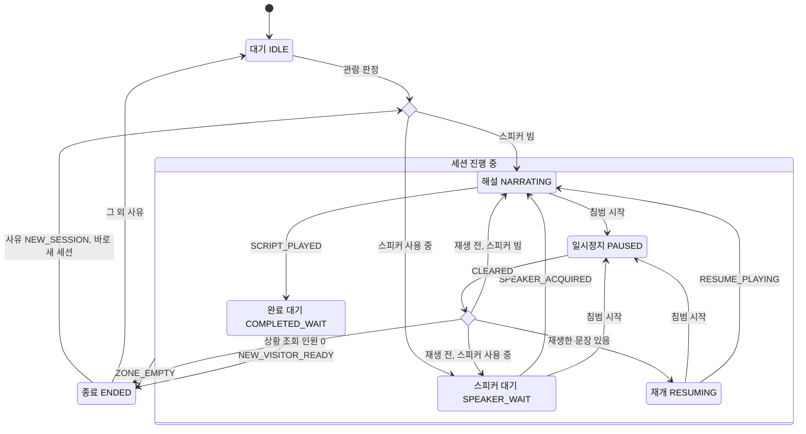
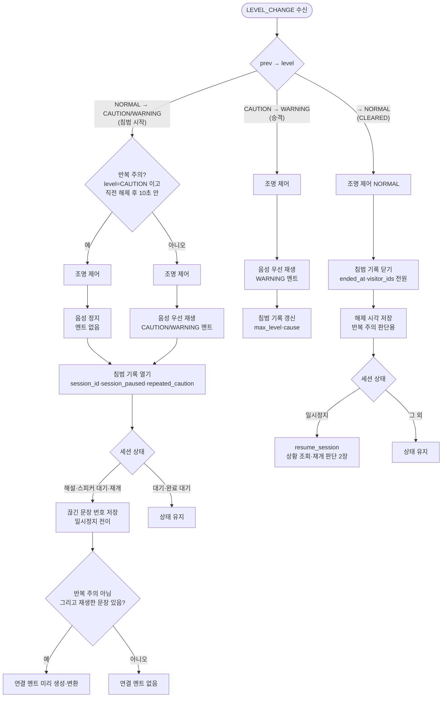
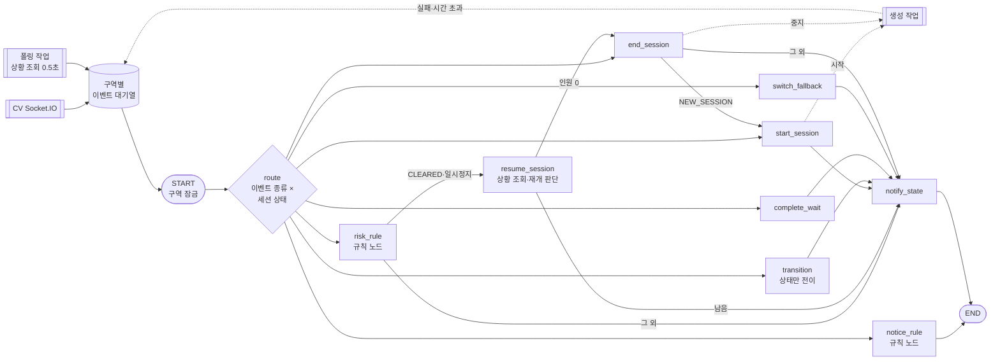
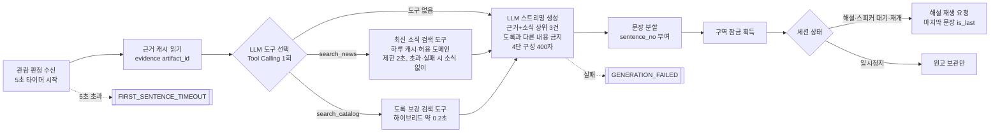
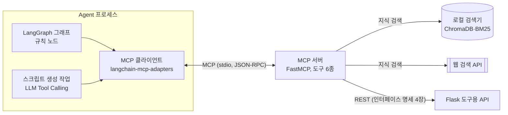

# LangGraph 도슨트 세션 상태도 v0.3

작성일 2026-11-05, 수정 2026-11-06(6.2 지식 검색 도구 선택, 6.3 MCP 연결 추가, ADR-0005). 담당 송용석(Agent). FR-AG-09~18과 `docs/requirements/decisions.md`의 도슨트 규칙을 상태 기계로 옮긴 2주차 UML 설계 산출물입니다. 용어는 `CONTEXT.md`, 형식은 `docs/interface/interface_spec_v0.1.md`를 따릅니다. 3주차 LangGraph 상태 제어 Loop(11/16~18)는 이 문서를 설계도로 구현합니다.

## 1. 기본 전제

- 세션은 **도슨트 구역(zone_id)마다 하나**. 상태 기계도 구역마다 따로 돈다(1차 구역 2개 → 상태 기계 2개).
- Agent가 받는 이벤트는 두 가지다.
  - **CV 이벤트**: `VIEWING_START`, `LEVEL_CHANGE`, `ZONE_EMPTY`, `PROHIBITED_ITEM` (Socket.IO, 네임스페이스 `/events`)
  - **내부 이벤트**: Agent가 상황 조회(0.5초 폴링)·스크립트 생성 작업에서 직접 만드는 이벤트(3장)
- 위험 단계는 CV가 판정한다(ADR-0002). Agent는 단계를 다시 계산하지 않고, 받은 `level` 변화에 따라 세션만 멈추고 잇는다.
- 위험 이벤트(`LEVEL_CHANGE`)·규칙 위반(`PROHIBITED_ITEM`)은 **세션 상태와 관계없이** 조명·멘트·기록을 처리한다. 세션 상태가 바뀌는 것은 해설·스피커 대기·재개 상태일 때뿐이다.
- **구역별 잠금**: 같은 구역의 그래프 실행과 생성 작업의 문장 전송은 구역별 잠금(`asyncio.Lock`) 하나로 순서를 지킨다. 생성 작업은 잠금 안에서 세션 상태를 확인한 뒤 해설 재생을 보낸다. 일시정지 처리 직후 다음 문장이 Flask 대기열에 들어가 침범 중에 재생되는 것을 막기 위해서다(6.2).

## 2. 세션 상태도

- **침범 시작** = `prev_level`이 `NORMAL`인 `LEVEL_CHANGE`. `cause`는 `LINE_1`(1차 안전선 → 주의), `LINE_2`(2차 안전선 → 경고), `TOUCH`(접촉 시도 → 경고 직행) 중 하나다. 접촉 시도도 CV가 경고로 판정해 같은 `LEVEL_CHANGE`로 보내므로 별도 이벤트를 두지 않는다(ADR-0002, Agent는 단계 변화만 보고 처리). 주의 중에 생긴 접촉 시도는 `CAUTION → WARNING`, `cause: TOUCH` 승격으로 들어온다(4장).
- `세션 진행 중` 묶음에서 나가는 `ZONE_EMPTY`는 다섯 상태 모두에 해당한다. 종료 사유는 직전 상태로 정한다(아래 표).
- `관람 판정`은 CV의 `VIEWING_START`와, 완료 대기 뒤 새 세션을 여는 내부 이벤트 `NEW_VISITOR_READY` 둘 다를 뜻한다.
- 시작 분기(스피커 빔/사용 중)는 상황 조회 결과로 정하고, 첫 문장의 해설 재생 응답 `speaker` 값이 다르면 그 값으로 바로잡는다(두 구역이 거의 동시에 관람 판정된 경우, 인터페이스 명세 7장 안건 8).
- 일시정지 중 주의 → 경고 승격은 상태를 바꾸지 않는다(경고 멘트·기록 갱신만, 4장).
- 그림에 없는 자기 전이: 모든 상태에서 `PROHIBITED_ITEM`은 상태를 바꾸지 않고 안내 재생·규칙 위반 기록만 한다. 대기·완료 대기 상태의 `LEVEL_CHANGE`도 상태는 그대로 두고 조명·멘트·침범 기록만 처리한다(4장). 대체 해설 전환(`FIRST_SENTENCE_TIMEOUT`·`GENERATION_FAILED`)도 상태를 바꾸지 않는다(3장).
- `ENDED`는 머무르지 않는 상태다. 정지 → 세션 기록 → 상태 통지를 마치면 바로 `IDLE`로 간다(FR-WEB-04 "종료는 기록 후 바로 대기로 표시").
- 새 세션 시작(`NEW_SESSION`)은 상태를 그 자리에서 리셋하지 않고 **종료를 거친다**. 이전 세션을 `ENDED`로 처리(정지·세션 기록 `NEW_SESSION`·상태 통지)한 뒤 `IDLE`에 머물지 않고 곧바로 관람 판정 분기(스피커 빔/사용 중)로 가서 새 세션을 연다. 이전 세션 기록을 빠짐없이 남기고, 새 세션 시작 코드를 관람 판정과 함께 쓰기 위해서다. 새 세션의 시작 인원은 그 시점 상황 조회의 구역 인원이다(6.1의 `end_session → start_session`).

### 종료 사유 5종

| 종료 직전 상태 | 계기 | end_reason |
|---|---|---|
| 완료 대기 | ZONE_EMPTY | `LEFT_AFTER_COMPLETE` 완료 후 이탈 |
| 해설·재개 | ZONE_EMPTY | `LEFT_DURING_NARRATION` 해설 중 이탈 |
| 일시정지 | CLEARED 후 상황 조회 인원 0, 또는 ZONE_EMPTY | `LEFT_WHILE_PAUSED` 일시정지 중 이탈 |
| 스피커 대기 | ZONE_EMPTY | `LEFT_WHILE_SPEAKER_WAIT` 스피커 대기 중 이탈 |
| 완료 대기 | NEW_VISITOR_READY | `NEW_SESSION` 새 세션 시작 |

- 재개 상태의 ZONE_EMPTY는 해설 중 이탈로 본다(재개는 관람객이 있는 것을 확인한 뒤 들어오므로 드묾).
- 일시정지 중 ZONE_EMPTY는 정상 흐름에서는 생기지 않는다(관람객이 나가면 CV가 CLEARED를 먼저 보냄). 순서가 어긋나 들어와도 같은 사유로 끝내는 방어 전이다.
- 원고가 끝나기 전에 종료된 세션(완료 후 이탈·새 세션 시작 외 3종)은 원고 끝 시점 인원·끝까지 들은 인원이 0(FR-AG-16).

## 3. 내부 이벤트

CV가 보내지 않지만 상태를 바꾸는 계기다. 폴링 작업이 상황 조회 응답(`GET /api/zones/status`)을 이전 값과 비교하거나, 생성 작업이 결과를 낼 때 만든다. CV 이벤트와 같은 구역 이벤트 대기열에 넣어 순서대로 처리한다.

| 내부 이벤트 | 만드는 곳 | 조건 | 쓰는 상태 |
|---|---|---|---|
| `SPEAKER_ACQUIRED` | 폴링 | 그 구역 `audio.state`가 `WAITING` → `PLAYING` | 스피커 대기 |
| `SCRIPT_PLAYED` | 폴링 | 그 구역 `audio.script_done_at`이 null → 값 | 해설 |
| `RESUME_PLAYING` | 폴링 | 재개 위치 문장(`audio.kind: SCRIPT`)이 재생 시작 | 재개 |
| `NEW_VISITOR_READY` | 폴링 | 세션 시작 ID 목록(`start_visitor_ids`)에 없던 ID가 2초 머묾, 해설 종료 후 10초 경과(이미 지났으면 즉시), 그 구역 단계 NORMAL | 완료 대기 |
| `FIRST_SENTENCE_TIMEOUT` | 생성 작업 타이머·폴링 | **관람 판정을 받은 시각**부터 5초가 지났는데 첫 문장 음성이 준비되지 않았고, 스피커가 비어 있음(스피커 대기 중이면 스피커가 빈 순간 폴링이 다시 확인) | 해설·스피커 대기 |
| `GENERATION_FAILED` | 생성 작업 | 웹 검색을 뺀 LLM·TTS·네트워크 실패(웹 검색은 2초 제한·실패 시 소식 없이 생성, 6.2) | 스피커 대기·해설·재개·일시정지 |

- 폴링은 해설·스피커 대기·재개·완료 대기 상태에서만 0.5초마다 돈다(대기·일시정지에서는 쉼).
- 해설 도중 합류한 관람객도 시작 목록에 없으므로 새 관람객 후보가 된다. 처음부터 듣지 못한 관람객이 완료 대기에 갇히지 않게 하기 위해서다(마지막 인사만 듣고 남은 관람객 등). 인원 비교 조건은 두지 않는다.
- `NEW_VISITOR_READY`의 머문 시간은 구역 단계가 NORMAL이 아니면 0으로 되돌린다. CV의 관람 판정 규칙(침범 시 머문 시간 초기화)과 맞추기 위해서다.
- `FIRST_SENTENCE_TIMEOUT`·`GENERATION_FAILED`는 상태를 바꾸지 않고 `switch_fallback` 노드가 처리한다. 대체 해설은 LLM 원고와 문장 구성이 달라 이어 붙일 수 없으므로 **한 문장이라도 재생했는지**(`played_any`)로 나눈다.
  - **재생 전**: 생성을 멈추고 대체 해설을 처음부터 보낸다(`fallback_used=true`, FR-AG-08). 일시정지 중이면 보관만 하고 재개 때 보낸다.
  - **재생 후**(해설 도중 실패): 대체 해설로 바꾸지 않는다. 이미 만든 문장까지 그대로 재생하고, 그 뒤에 공통 마무리 멘트 `END_COMMON`을 `is_last`로 보내 원고를 끝낸다(인터페이스 명세 7장 안건 9). 그러면 `SCRIPT_PLAYED`로 평소처럼 완료 대기로 넘어간다. 일시정지 중이면 재개 때 재개 위치부터 남은 문장과 마무리 멘트를 보낸다. `fallback_used`는 false로 두고 세션 기록에 생성 실패를 남긴다.
- 재생 후에는 첫 문장이 이미 나왔으므로 `FIRST_SENTENCE_TIMEOUT`은 생기지 않는다.

## 4. 위험 이벤트 처리 (규칙 노드, LLM 없음)

`LEVEL_CHANGE`는 세션 상태보다 먼저 이 규칙 노드를 거친다(FR-AG-10·12·18).

- 끊긴 문장 번호: 우선 재생 응답 `interrupted.sentence_no`(같은 구역일 때)나 정지 응답 `interrupted_sentence_no`를 재개 위치로 저장한다. null이면 앞서 저장한 값을 그대로 둔다(인터페이스 명세 4.3).
- 스피커 대기 중 일시정지: 이 구역이 미리 보낸 문장이 Flask 대기열에 남아 있으면 앞 구역 원고가 끝날 때 침범 중인데도 재생된다. 우선 재생·정지가 **요청한 구역의 대기열**을 비우도록 한다(인터페이스 명세 7장 안건 3). 재생 전에 멈췄으므로 재개 때 1번 문장부터 다시 보낸다.
- 일시정지 중에도 스크립트 생성은 끝까지 마치고 원고는 Agent가 보관한다. 송출만 멈춘다(FR-AG-07).
- 연결 멘트: 일시정지 시점에 LLM으로 만들고 `POST /api/audio/prepare`로 미리 변환한다. 해제 때 기다리지 않는다. 그 시점에 아직 준비되지 않았거나 실패했으면, 또는 대체 해설 중이면 바로 `BRIDGE_COMMON`을 쓴다(NFR-16 3초). 반복 주의 해제와 재생한 문장이 없는 세션은 연결 멘트 없이 잇는다(FR-AG-11·12).
- 재개할 때는 대기열이 비워져 있으므로 연결 멘트 뒤에 **재개 위치부터 남은 문장을 모두 다시 보낸다**(아직 생성 중이면 이후 문장은 생성 작업이 이어서 보냄).
- 반복 주의는 주의에만 적용한다. 경고는 반복이어도 항상 경고 멘트를 낸다. 기준은 직전 침범(주의·경고 모두) 해제 후 10초다.

## 5. 상태 전이표

| 현재 상태 | 이벤트 | 조건 | 동작 (MCP 도구) | 다음 상태 | 근거 |
|---|---|---|---|---|---|
| 대기 | VIEWING_START | 스피커 비어 있음 | 세션 ID 발급, 관람 판정 시각·시작 인원 저장, 생성 작업 시작, 상태 통지 | 해설 | FR-AG-07·09 |
| 대기 | VIEWING_START | 다른 구역 사용 중 | 위와 같음(문장은 Flask 대기열에 미리 보냄) | 스피커 대기 | FR-AG-09 |
| 스피커 대기 | SPEAKER_ACQUIRED | | 상태 통지 | 해설 | NFR-03 |
| 해설·스피커 대기 | FIRST_SENTENCE_TIMEOUT | 재생 전 | 생성 중지, 대체 해설 처음부터 | 그대로 | FR-AG-08 |
| 스피커 대기·해설·재개·일시정지 | GENERATION_FAILED | 재생 전 / 재생 후 | 재생 전: 대체 해설 처음부터 / 재생 후: 만든 문장까지 + `END_COMMON` | 그대로 | FR-AG-08 |
| 스피커 대기·해설·재개 | LEVEL_CHANGE 침범 시작 | | 4장 규칙 노드 → 일시정지 | 일시정지 | FR-AG-10 |
| 해설 | SCRIPT_PLAYED | | 원고 끝 시점 인원 저장(청취 통계), 상태 통지 | 완료 대기 | FR-AG-17 |
| 일시정지 | LEVEL_CHANGE CLEARED | 상황 조회 인원 0 | 정지, 세션 기록, 상태 통지 | 종료 → 대기 | FR-AG-11·14 |
| 일시정지 | LEVEL_CHANGE CLEARED | 재생한 문장 있음 | 연결 멘트(또는 생략) + 재개 위치부터 남은 문장 다시 보냄 | 재개 | FR-AG-11 |
| 일시정지 | LEVEL_CHANGE CLEARED | 재생한 문장 없음 | 첫 문장부터 다시 보냄(스피커 사용 중이면 대기열) | 해설 / 스피커 대기 | FR-AG-11 |
| 재개 | RESUME_PLAYING | | 상태 통지 | 해설 | NFR-16 |
| 완료 대기 | NEW_VISITOR_READY | | 정지, 이전 세션 기록(NEW_SESSION) 후 새 세션 시작 | 종료 → 해설 / 스피커 대기 | FR-AG-17 |
| 스피커 대기·해설·재개·일시정지·완료 대기 | ZONE_EMPTY | | 생성 작업 중지, 정지, 세션 기록(종료 사유 표), 상태 통지 | 종료 → 대기 | FR-AG-14 |
| 모든 상태 | PROHIBITED_ITEM | | 안내 재생, 규칙 위반 기록 | 그대로 | FR-AG-13 |
| 대기·완료 대기 | LEVEL_CHANGE | | 4장 규칙 노드(조명·멘트·기록만) | 그대로 | FR-AG-10 |
| 대기 | ZONE_EMPTY | | 무시 | 대기 | |
| 세션 있음 | VIEWING_START | | 무시하고 로그만(CV는 구역이 빈 뒤 한 번만 보냄) | 그대로 | 명세 2장 |

## 6. LangGraph 구현 구조

### 6.1 이벤트 처리 그래프

이벤트 하나가 들어올 때마다 그래프를 한 번 실행하고, 구역별 세션 상태는 체크포인터에 `thread_id = zone_id`로 남긴다. 해설 생성처럼 오래 걸리는 일은 그래프 밖의 비동기 작업으로 띄우고, 실패·시간 초과는 내부 이벤트로 다시 그래프에 넣는다. 그래프 한 번 실행은 짧게 끝나야 위험 이벤트가 생성 작업에 막히지 않는다(NFR-02 1초). 그래프 실행 전체는 그 구역의 잠금 안에서 돈다(1장).

| 이벤트 | 세션 상태 | 노드 |
|---|---|---|
| `LEVEL_CHANGE` | 모든 상태 | `risk_rule` (CLEARED이고 일시정지면 `resume_session`으로) |
| `VIEWING_START` | 대기 | `start_session` (그 외 상태는 무시·로그) |
| `SPEAKER_ACQUIRED` | 스피커 대기 | `transition` → 해설 |
| `RESUME_PLAYING` | 재개 | `transition` → 해설 |
| `SCRIPT_PLAYED` | 해설 | `complete_wait` (원고 끝 시점 인원 저장 → 완료 대기) |
| `NEW_VISITOR_READY` | 완료 대기 | `end_session`(NEW_SESSION) → `start_session` |
| `ZONE_EMPTY` | 대기 외 | `end_session` (대기면 무시) |
| `PROHIBITED_ITEM` | 모든 상태 | `notice_rule` |
| `FIRST_SENTENCE_TIMEOUT`·`GENERATION_FAILED` | 세션 있음 | `switch_fallback` |

- `resume_session`: 상황 조회로 구역 인원을 확인해 0이면 `end_session`(`LEFT_WHILE_PAUSED`), 남아 있으면 2장의 재개 분기(재개 / 해설 / 스피커 대기)대로 해설 재생을 보낸다.
- `end_session → start_session`: 종료 사유가 `NEW_SESSION`이면 같은 실행 안에서 조건부 엣지로 `start_session`을 이어 부른다(이벤트를 다시 넣지 않음). 그 외 사유는 `notify_state`로 끝난다.
- `notify_state`는 상태가 바뀌었을 때만 상태 통지 도구를 부른다.
- 같은 구역 이벤트는 대기열로 하나씩 처리하고, 구역끼리는 따로 돈다(스피커 차례는 Flask 대기열이 정하고, Agent는 해설 재생 응답의 `speaker` 값으로 확인, 7장 안건 8).

### 6.2 스크립트 생성 작업

- 근거 캐시는 Agent 시작 때 미리 계산해 둔 Re-ranking 결과라 관람 판정 시점 검색은 캐시 읽기다(`agent/retrieval/README.md`).
- **지식 검색은 LLM이 고른다(ADR-0005).** 근거 캐시의 기본 근거를 넣은 프롬프트와 함께 LLM에 MCP 도구 `search_catalog`·`search_news`만 연결하고, LLM이 보강 검색·최신 소식 검색을 할지와 질의를 정한다. 도구 라운드는 1회(동시 호출 가능)로 제한하고 바로 스트리밍 생성으로 넘어간다. 하루 캐시·허용 도메인·2초 제한은 `search_news` 도구 안에서 지킨다. `tool_choice: fixed`면 도구 선택 없이 코드가 유물 이름 질의로 `search_news`를 부른다(5초를 못 지킬 때의 대안).
- **5초 타이머는 관람 판정을 받은 순간** 시작한다. 웹 검색·LLM 요청 시점부터 재면 검색 시간만큼 실제 지연이 NFR-03(관람 판정 → 첫 문장 5초)을 넘어도 대체 해설로 바뀌지 않는다.
- 웹 검색은 2초 안에 끝나지 않거나 실패하면 최신 소식 없이 생성한다(4단 구성의 ③ 생략, 출처 URL 없음). 웹 검색 실패는 `GENERATION_FAILED`가 아니다.
- **도록 대조는 별도 단계가 아니다.** 근거 청크와 검색 결과 상위 3건을 생성 프롬프트에 함께 넣고 "도록과 다른 내용은 쓰지 말고 맞는 소식 1개만 쓸 것"으로 지시한다. LLM은 스크립트 생성에만 쓴다는 원칙과 맞추고 단계를 줄이기 위해서다. 실제로 쓴 소식의 URL만 세션 기록에 남기도록 생성 결과에 출처 표시를 받는다.
- 문장 전송은 구역 잠금 안에서 상태를 확인하고 보낸다. 그래프가 일시정지를 처리하는 동안에는 잠금을 얻지 못해 기다리고, 잠금을 얻은 뒤에는 일시정지 상태를 보고 보관만 한다.

### 6.3 MCP 연결 (ADR-0005)

| 호출 주체 | 도구 | 선택 방식 |
|---|---|---|
| 스크립트 생성 작업의 LLM | `search_catalog`, `search_news` | LLM이 Tool Calling으로 선택·질의 작성 |
| 규칙 노드·세션 노드 | 조명·음성 송출·기록 저장·상태 통지·Vision 상황 조회 | 5장 상태 전이표대로 코드가 정해진 인자로 호출, LLM 없음 |
| 폴링 작업 | `get_zone_status` | 0.5초마다 코드가 호출 |

- Agent가 시작할 때 MCP 서버를 stdio 자식 프로세스로 띄우고 도구 목록을 한 번 불러온다. 서버가 끊기면 다시 띄운다.
- 5장 표의 "동작 (MCP 도구)"는 모두 이 MCP 클라이언트를 거쳐 호출한다. 규칙 노드도 같은 경로를 쓰므로 도구 정의는 MCP 서버 한 곳에만 있다.

## 7. 세션 상태 필드 (LangGraph State)

| 필드 | 설명 |
|---|---|
| `zone_id`, `artifact_id`, `speaker_id` | 구역 정보(공간 설정 파일) |
| `session_id`, `state`, `paused_from` | 세션 ID, 현재 상태, 일시정지 직전 상태(해설·스피커 대기·재개) |
| `viewing_at` | 관람 판정을 받은 시각(첫 문장 5초 기준) |
| `sentences`, `sent_upto`, `resume_no`, `played_any` | 생성된 문장, Flask에 보낸 마지막 번호, 재개 위치, 한 문장이라도 재생했는지 |
| `fallback_used`, `generation_failed`, `bridge_audio` | 대체 해설 사용 여부, 해설 도중 생성 실패 여부, 미리 변환한 연결 멘트 경로 |
| `start_visitor_ids`, `script_end_visitor_ids`, `script_done_at` | 시작 인원, 원고 끝 시점 인원, 원고 재생이 끝난 시각 |
| `candidates` | 완료 대기 중 새 관람객 후보 `{visitor_id: 처음 본 시각}` |
| `level`, `intrusion_record_id`, `last_cleared_at`, `repeated` | 현재 위험 단계, 열린 침범 기록, 직전 해제 시각, 반복 주의 여부 |
| `rag_chunk_ids`, `source_urls` | 세션 기록용 도록 근거·최신 소식 출처 |

## 8. 미결 사항

인터페이스와 관련된 항목은 인터페이스 명세 7장(11/11 확정 안건)에 함께 올린다.

1. 인터페이스 안건 2(`audio.kind`)·3(요청 구역 대기열 비우기)·8(해설 재생 응답 `speaker`)·9(`END_COMMON`)이 이 상태도의 전제다. 11/11 회의에서 확정한다.
2. 대체 해설 중 일시정지 후 재개: 대체 해설은 문장별 파일이라 멈춘 문장부터 잇고 연결 멘트는 `BRIDGE_COMMON`. 별도 결정 불필요, 확인만.

## 변경 이력

| 버전 | 날짜 | 내용 |
|---|---|---|
| v0.1 | 2026-11-05 | 최초 작성 |
| v0.2 | 2026-11-05 | 검토 반영: 구역별 잠금, 6.1 `transition`·`resume_session` 엣지와 라우팅 표, 5초 타이머 기준(관람 판정 수신), 웹 검색 2초 제한, 도록 대조를 생성 프롬프트로, 해설 도중 생성 실패 처리(`END_COMMON`), 연결 멘트 대기 없음, 재개 시 남은 문장 다시 보냄, 반복 주의 기준 확정 |
